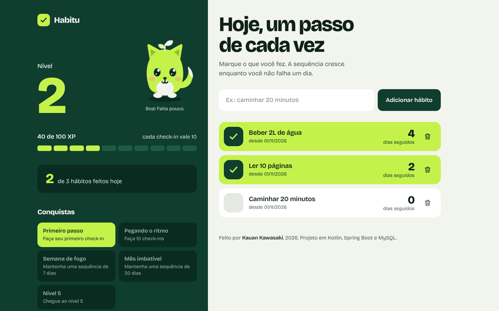
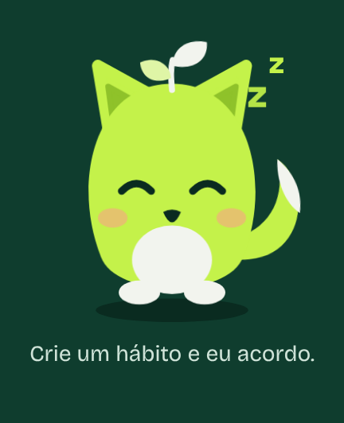
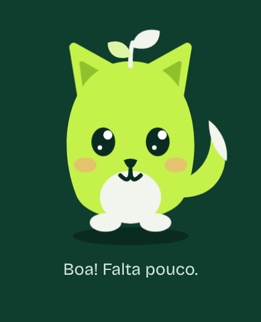
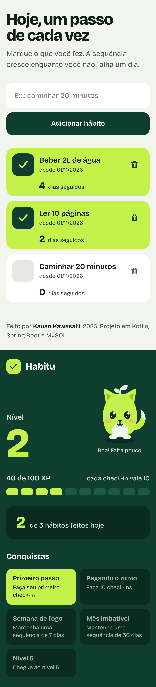
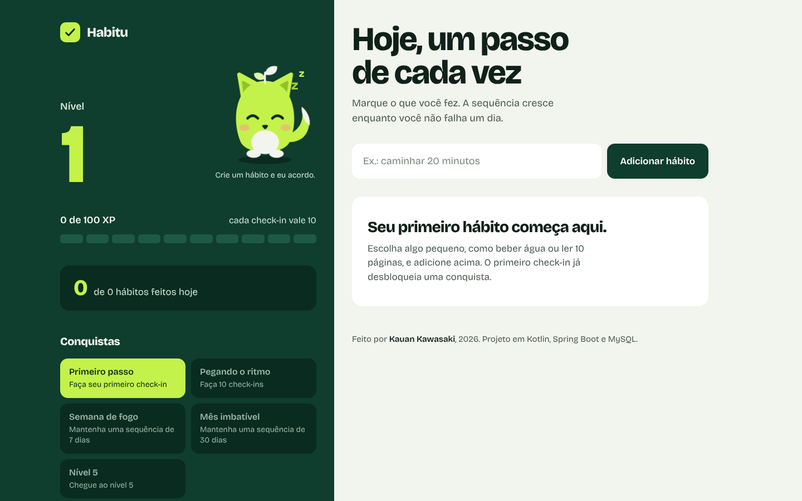

# Habitu


App web de hábitos com gamificação, feito em **Kotlin e Spring Boot**. Você cria seus hábitos, marca o que fez a cada dia e ganha XP, sobe de nível, mantém sequências de dias e desbloqueia conquistas. Quem acompanha tudo é o **Fito**, o mascote do app.

**Demo no ar:** https://habitu-h3n8.onrender.com/

> Aviso: o demo é público e compartilhado, então todo mundo vê os mesmos hábitos. Não cadastre dados pessoais. Ele roda no plano grátis do Render, que "dorme" quando fica parado, então o primeiro acesso pode demorar cerca de 30 segundos.



## O que o app faz

- **Hábitos:** cadastre e exclua hábitos.
- **Check-in diário:** marque o que você fez hoje (e desmarque, se errou).
- **XP e nível:** cada check-in vale **10 XP** e a cada **100 XP** você sobe de nível. A barra de XP tem 10 segmentos, um para cada check-in.
- **Sequência de dias:** quantos dias seguidos você manteve cada hábito.
- **Conquistas:** Primeiro passo, Pegando o ritmo (10 check-ins), Semana de fogo (7 dias seguidos), Mês imbatível (30 dias seguidos) e Nível 5.
- **Fito, o mascote:** reage ao seu dia (veja abaixo).

## Conheça o Fito

O Fito é uma raposinha com um brotinho na cabeça, o símbolo de um hábito que cresce. Ele muda conforme o seu progresso do dia:

| Dormindo | Feliz | Festa |
| :---: | :---: | :---: |
|  |  |  |
| Nenhum check-in hoje | Já fez alguns | Fez todos os hábitos |

Ele também pisca, abana o rabo, respira, e as pupilas seguem o mouse. Ao tocar nele, ele faz cara de carinho e solta coraçõezinhos. As animações são desligadas para quem usa "reduzir movimento" no sistema.

## Telas

| Celular | Sem hábitos ainda |
| :---: | :---: |
|  |  |

Os prints são renders da própria interface com dados de exemplo.

## Tecnologias

- Kotlin 2.3 e Spring Boot 4.1 (Spring MVC, Spring Data JPA e Hibernate)
- MySQL (local ou na nuvem)
- Thymeleaf, HTML e CSS puro (sem framework de CSS)
- Gradle, JUnit (testes da lógica de gamificação) e GitHub Actions
- Docker, hospedado no Render, com banco MySQL na Aiven

## Como rodar na sua máquina

Pré-requisitos: JDK 17 e MySQL rodando na porta 3306.

```bash
git clone https://github.com/KAUAN-KAWASAKI/habitu.git
cd habitu
```

A configuração vem de variáveis de ambiente. Se você não definir nada, o app usa o MySQL local, o banco `habitudb` (criado automaticamente) e o usuário `root`:

| Variável | Para que serve | Padrão |
| --- | --- | --- |
| `DB_URL` | endereço JDBC do banco | MySQL local, banco `habitudb` |
| `DB_USERNAME` | usuário do banco | `root` |
| `DB_PASSWORD` | senha do banco | vazio |
| `PORT` | porta do servidor | `8080` |

```bash
# Linux ou Mac
DB_PASSWORD=sua_senha ./gradlew bootRun

# Windows (PowerShell)
$env:DB_PASSWORD="sua_senha"; .\gradlew.bat bootRun
```

Depois abra http://localhost:8080. Nunca coloque senhas no código ou no repositório.

Para rodar os testes: `./gradlew test`

## Como funciona a gamificação

As regras ficam em `Gamificacao.kt` e são **calculadas na hora**, a partir dos check-ins gravados. Nada de XP ou nível é salvo no banco, então não há risco de ficar fora de sincronia.

- XP total = número de check-ins × 10
- Nível = XP total ÷ 100 + 1
- Sequência: conta os dias seguidos para trás, a partir de hoje (ou de ontem, se hoje ainda não foi feito, para não "perder" a sequência antes do fim do dia)

## Estrutura

```
src/main/kotlin/com/TodoListKotlin/TodoList/
  model/          Habito e CheckIn (entidades JPA)
  repository/     HabitoRepository e CheckInRepository
  controller/     HabitoController (telas e ações)
  gamificacao/    Gamificacao (XP, nível, sequência, conquistas)
src/main/resources/templates/tasks.html   tela única (HTML, CSS e o Fito em SVG)
src/test/                                  testes da gamificação
Dockerfile                                 build em dois estágios para o deploy
```

## Próximos passos

- Tela de login, para cada pessoa ter os seus próprios hábitos
- Renomear o pacote e o template para refletir o nome Habitu

## Autor

Feito por **Kauan Kawasaki**.
